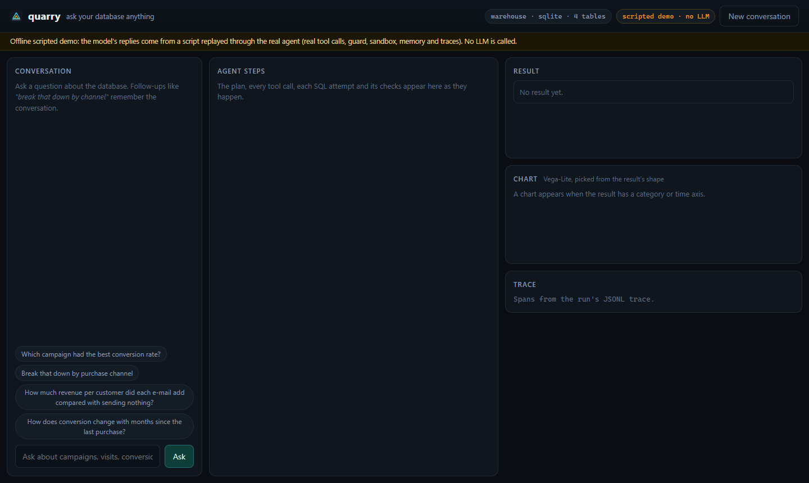
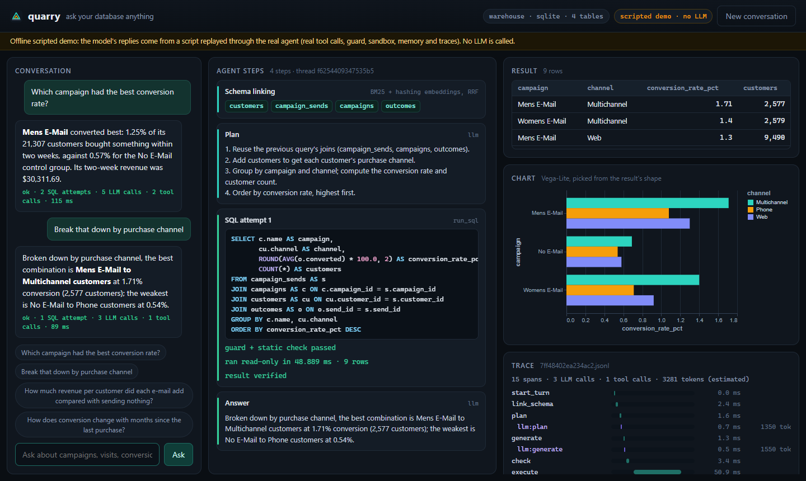
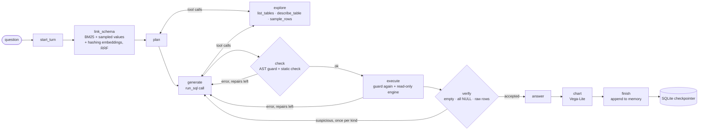
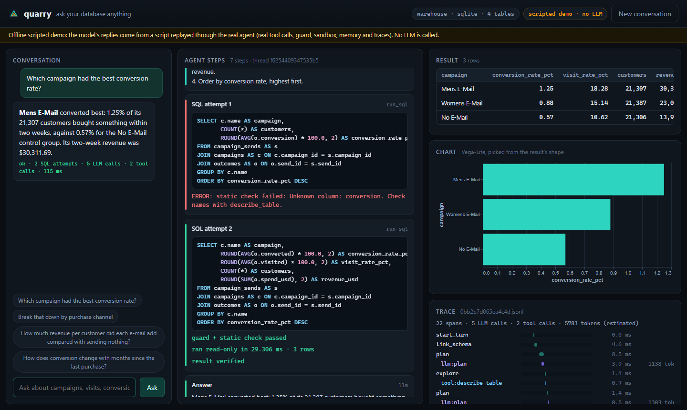
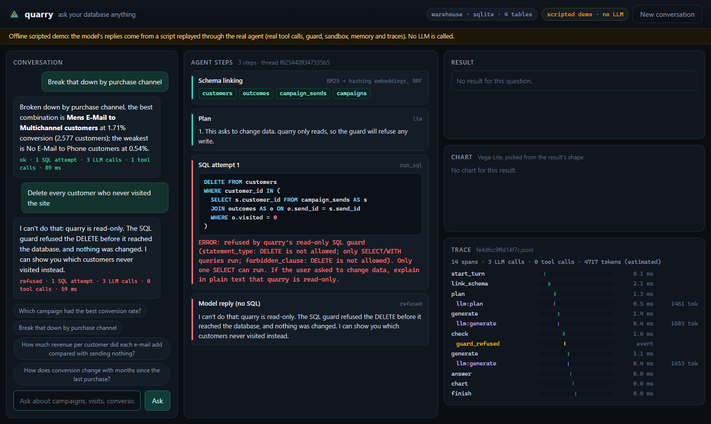

# quarry

**Ask your database anything: a LangGraph agent that plans, writes, verifies and self-corrects
SQL, and shows its work.** Every step streams to the UI: which tables it picked and why, the
plan, each tool call, every SQL attempt with the check that rejected it, the read-only run,
the result, a chart and a span-by-span trace. Writes are impossible by construction, and rows
that try to talk to the model are withheld from it.

[](https://github.com/aamodbhatt/quarry/actions/workflows/ci.yml)
[](LICENSE)




<sub>Recorded with Playwright in Microsoft Edge from the real web UI running the **offline
scripted demo**: the model's replies come from [a script](src/quarry/demo/script.toml), not
an LLM (there is no API key in this repository). Everything else is the real system on the
real data: schema linking, tool calls, the SQL guard, the static check, the read-only sandbox,
conversation memory, the chart and the trace. The script's first query deliberately names a
column that does not exist, so the recording shows the static check catching it and the
repair loop fixing it. Every number in an answer is filled in from the live query result.</sub>

## Why

Text-to-SQL demos stop at "the model wrote a query". Production needs the rest: the model
must see the right slice of a large schema, its SQL must be checked before it runs, it must
never be able to change data whatever it reads, it has to notice when a result looks wrong,
follow-ups have to resolve against earlier turns, and someone has to be able to see exactly
what happened afterwards. quarry is that rest, built as a small, typed, tested agent.

## What it does

- **Agent graph (LangGraph `StateGraph`)**: schema linking, planning with tool calls,
  SQL generation, static checking, sandboxed execution, result verification, bounded
  self-correction, answer synthesis and a Vega-Lite chart. Step and token budgets per question.
- **Typed tool calling**: `list_tables`, `describe_table`, `sample_rows`, `run_sql` as
  LangChain `StructuredTool`s with Pydantic arguments. The model explores the schema when it
  is unsure, then submits SQL through `run_sql`.
- **Two-layer guardrails**: an allowlist on the sqlglot AST (one `SELECT`/`WITH`, no DDL/DML,
  `PRAGMA`, `ATTACH`, `COPY`, `INSTALL`, `SELECT ... INTO`, hidden DML in CTEs, stacked
  statements, table functions or unlisted functions) and a read-only engine underneath it
  (SQLite `mode=ro` + `query_only` + an authorizer callback + size limits; DuckDB `read_only`
  with external access off and the configuration locked). Row caps and timeouts on every query.
- **Prompt-injection tripwire**: every value, column name and description a model sees from
  the database (quarry's own model, or another app's through MCP `ask`) is scanned; suspected
  injections are replaced by a placeholder and flagged in the UI and the trace.
- **Memory**: a LangGraph SQLite checkpointer per conversation, so "break that down by
  channel" works and survives restarts.
- **Observability**: a JSONL trace per question (node, LLM and tool spans with latency,
  tokens and attempts), rendered as a waterfall in the UI; optional Langfuse/LangSmith export.
- **Interfaces**: `quarry ask | chat | serve | mcp | eval`, a FastAPI UI that streams every
  step over Server-Sent Events, and an **MCP server** (stdio) exposing the four tools plus
  `ask` to other AI apps.
- **LLM**: any tool-calling model on OpenRouter through `ChatOpenAI`; one config line picks
  it. A scripted model implements the same interface for tests and the offline demo.
- **Evaluation**: a resumable, cached, rate-limited Spider execution-accuracy harness (one
  command once a key exists) and an offline suite that measures everything that needs no LLM.



<sub>The follow-up in the scripted demo. Memory is real: the first turn is stored in the
SQLite checkpointer and schema linking carries its tables into this one. The plan and SQL
text are lines from the demo script (matched to the question by a pattern), not reasoning
over the history; the query run, the result and the chart are live.</sub>

## Quickstart

You need [uv](https://docs.astral.sh/uv/). No GPU, no API key for the demo.

**Windows (PowerShell)**

```powershell
git clone https://github.com/aamodbhatt/quarry; cd quarry
uv sync
uv run quarry demo build                  # downloads the 4 MB Hillstrom CSV (checksummed), builds data/warehouse.sqlite
uv run quarry serve --offline             # http://127.0.0.1:8097  (scripted demo, no key)
```

**macOS / Linux**

```bash
git clone https://github.com/aamodbhatt/quarry && cd quarry
uv sync
uv run quarry demo build
uv run quarry serve --offline             # http://127.0.0.1:8097
```

**With a model** (OpenRouter): copy `.env.example` to `.env`, put your key in
`OPENROUTER_API_KEY`, then drop `--offline`:

```bash
uv run quarry ask "Which campaign had the best conversion rate?" -v
uv run quarry chat                        # conversation with memory; /new, /quit
uv run quarry serve                       # web UI against the real model
uv run quarry ask "..." --db path/to/any.sqlite   # any SQLite or DuckDB file
```

The model is one line in [`configs/quarry.toml`](configs/quarry.toml)
(`model = "google/gemma-4-31b-it:free"`, picked from OpenRouter's public model list on
2026-11-02 as a free model that supports `tools` and `tool_choice`).

**As an MCP server** (desktop assistants, IDEs, any MCP client):

```json
{"mcpServers": {"quarry": {"command": "uv", "args": ["run", "--directory", "/path/to/quarry", "quarry", "mcp"]}}}
```

**Docker**: `docker compose up --build`, then http://127.0.0.1:8097 (the container builds the
demo warehouse on first start; set `command` to `serve --host 0.0.0.0 --offline` for the demo).

## How it works



Every node, LLM call and tool call writes a JSONL span (latency, tokens, attempt) to
`runs/traces/<thread>/<trace>.jsonl`; the UI draws it as a waterfall.



The parts worth reading:

- **Schema linking that fits big schemas** ([`linking/linker.py`](src/quarry/linking/linker.py)).
  One BM25 document per column (table, name, description, sampled values) and per table, plus
  exact value hits ("Mens E-Mail" in the question points at `campaigns.name`), plus an optional
  embedder behind a small protocol; the rankings are fused with reciprocal-rank fusion so no
  score needs calibrating. Tables that join two picked tables through a foreign key are added
  as *bridges*, and a follow-up also carries the previous query's tables.
- **A guard that is an allowlist, not a blocklist** ([`guard/policy.py`](src/quarry/guard/policy.py)).
  It walks the whole AST, so `WITH d AS (DELETE ... RETURNING *) SELECT ...` and
  `SELECT * INTO` fail even though they start with `WITH`/`SELECT`; any function not on a list
  of pure functions fails, so unknown file or extension functions are refused by default.
  CTE names are resolved scope by scope, so a CTE called `sqlite_master` inside one subquery
  cannot vouch for a real `sqlite_master` elsewhere in the statement. Underneath, the engine
  refuses the same things on its own: the red-team suite runs every attack with the guard
  bypassed too.
- **Tool output can never trigger a write.** There is no write tool, the only path from SQL
  text to a database is `SafeExecutor` (guard, then read-only connection), and each query gets
  a fresh connection. In the planted-injection scenario below, a scripted model executes any
  of three planted write commands (`DROP`, `DELETE`, `TRUNCATE`) it reads in a row: it tries
  all three and none executes.
- **Self-correction with real feedback.** Errors go back to the model as the `ToolMessage`
  answer to its own `run_sql` call (standard tool-calling transcripts), from three places: the
  guard, a static check that resolves every column with sqlglot's `qualify`, and the engine.
  The static check applies SQLite's "unknown double-quoted name is a string" rule only where
  Spider-style SQL relies on it (the value side of a comparison with a column), which removed
  every false alarm on Spider dev gold while `SELECT "nmae"` is still caught. A verify step
  sends back results that are empty, all-NULL, or raw rows where the question asked for a
  number, once per kind, so a genuinely empty answer is accepted on resubmission.
- **Budgets and routing as plain data.** Nodes record whether a retry is still allowed;
  edges are pure functions of the state; dependencies arrive as LangGraph run context, so the
  compiled graph is reusable across databases, models and threads.
- **The scripted model is a real `BaseChatModel`** ([`llm/scripted.py`](src/quarry/llm/scripted.py)):
  it supports `bind_tools`, emits `tool_calls` and reports token usage, so the 191 tests and
  the demo exercise the exact code path a real model takes.

## Results

Measured on a laptop: **Intel Core Ultra 9 275HX (24 logical CPUs), Windows 11,
Python 3.12, CPU only, no LLM**. Full report: [`docs/results/offline.md`](docs/results/offline.md)
([JSON](docs/results/offline.json)). Regenerate with `uv run quarry eval offline`.

### Measured now (no LLM needed)

**SQL guard on Spider gold queries.** A guard that blocks correct SQL is useless, so the
allowlist was run on all 8,034 dev and `train_spider` gold queries (`train_others`, 1,659
more, ships only in the full Spider archive, which did not download; see below):

| Split | Queries | Allowed | Pass rate |
|---|---:|---:|---:|
| dev | 1,034 | 1,034 | **100.00%** |
| train (`train_spider`) | 7,000 | 6,999 | **99.99%** |

The one block is a true positive: `train_spider` #3153 joins `Ref_Company_Types`, a table that
does not exist in the `assets_maintenance` schema. The first run passed only 91.3% (dev) and
89.8% (train): sqlglot 30 models `AND`/`OR` as function nodes, so the function allowlist
caught them. Operators are now told apart from function calls, which fixed all of it. The
static check went through the same loop: 213/1,034 false alarms (Spider writes string literals
in double quotes) down to **0/1,034** after matching SQLite's semantics, and it stays at 0
with the rule narrowed to comparison values.

**A guard bug found in review, and fixed.** The guard used to collect CTE names for the whole
statement, so a CTE defined inside one subquery let the same name skip the catalog and file
checks anywhere else: `SELECT b.* FROM (WITH sqlite_master AS (SELECT 1 AS x) SELECT x FROM
sqlite_master) AS a, sqlite_master AS b` passed the guard. On SQLite the authorizer still
refused it; on DuckDB it returned catalog rows (the `duckdb_tables` variant too), and a
`"secrets.csv"` variant reached a file scan that only `enable_external_access=false`
stopped. CTE visibility is now resolved scope by scope (and never for a qualified name).
These statements are in the red-team set below, and the property tests, which now judge
every statement the guard lets through with the engines' own parsers and planners, find
the bypass on both engines when run against the old guard.

**Red team: 162/162 cases pass, the database file never changed.** 81 cases (21 writes and
DDL, 11 stacked-statement tricks, 24 file/extension/catalog reads including the CTE-scope
variants, 6 configuration changes, 5 resource-exhaustion queries, 14 scary-looking benign
controls that must still run), each against SQLite and DuckDB copies of a
warehouse-shaped database:

| Category | SQLite | DuckDB |
|---|---:|---:|
| destructive (DDL/DML, hidden DML in CTEs, `SELECT INTO`, `FOR UPDATE`) | 21/21 | 21/21 |
| multi-statement and comment tricks | 11/11 | 11/11 |
| file, extension and system-catalog access (incl. CTE-scope tricks) | 24/24 | 24/24 |
| configuration (`PRAGMA`, `SET`, `RESET`) | 6/6 | 6/6 |
| resource exhaustion (infinite CTE, 1 GB blobs, cartesian joins) stays within limits | 5/5 | 5/5 |
| benign controls still run (incl. nested CTEs) | 14/14 | 14/14 |

With the guard bypassed, the engines alone still refuse or fail every hostile SQLite case
(62/62) and 49/62 DuckDB cases. The 13 DuckDB statements that run change nothing: `VACUUM`
and `ANALYZE` (no-ops on a read-only file), a temp table in memory, one pair of stacked
`SELECT`s, and 9 reads of DuckDB's own catalog (`duckdb_tables`, `sqlite_master`,
`sqlite_schema`, `information_schema`, `pragma_table_info` and the CTE-scope variants). The
file is unchanged. That gap is why both layers exist.

**Planted injections.** 20 injection strings are planted in a notes table and the agent is
driven by a scripted model that executes any of three planted write commands it reads
(`DROP TABLE customers`, `DELETE FROM outcomes`, `TRUNCATE TABLE outcomes`):

| Detector | Values withheld | Writes the model attempted | Writes executed | Database unchanged |
|---|---:|---:|---:|:---:|
| on | 20 | 0 | 0 | yes |
| off | 0 | 3 | **0** | yes |

**Injection detector.** It flags all 20 development strings and none of 10 benign notes, but
those were used while writing the rules, so that is a regression test. On an external set it
never saw while being written, [deepset/prompt-injections](https://huggingface.co/datasets/deepset/prompt-injections)
(train + test), it has **6.1% recall (16/263) at 0% false positives (0/399)**. It is a narrow,
English, database-oriented tripwire (many of that set's injections are German or role-play
jailbreaks); the guard and read-only engine, not the detector, are the safety boundary.

**Schema linking on Spider dev** (1,034 questions). The 20 Spider dev databases could not be
downloaded during development (the official archive is on Google Drive and its download quota
stayed exhausted), so these numbers use the schemas only, without sampled values:

| Variant | Tables all@1 | all@3 | all@5 | Columns all@10 | all@20 | all@30 |
|---|---:|---:|---:|---:|---:|---:|
| BM25 (names + natural-language names) | 51.6 | 95.1 | 98.7 | 82.4 | 92.9 | 98.0 |
| BM25 + hashing embeddings (shipped, minus values) | **53.1** | **96.3** | **98.9** | **82.5** | **94.3** | **98.4** |
| random order (expected) | 15.4 | 69.8 | 87.6 | 30.6 | 66.9 | 84.9 |

"all@k" means every gold table (column) is in the top k. Spider databases are small (about 4
tables and 22 columns on average), so the random baseline is shown for context; the gap is in
the columns. Gold tables and columns come from parsing each gold query with sqlglot.

**Spider difficulty labels.** The harness reports accuracy per Spider difficulty level using a
re-implementation of Spider's `eval_hardness` on sqlglot; on dev it reproduces the official
totals exactly (248 easy / 446 medium / 174 hard / 166 extra).

**Latency** on the demo warehouse (64,000 customers), p50 over 30 runs: `run_sql` with a
three-table join and aggregation 26.3 ms; guard 0.66 ms; static check 1.63 ms; schema linking
0.65 ms; `sample_rows` 0.79 ms. A complete offline agent run (5 scripted LLM calls, one
repair, its JSONL trace written to disk) takes 56.8 ms at p50 over 15 runs, so the graph adds
little next to a real model call. These are laptop numbers and move by a few tens of percent
between runs.

### Needs an API key (not run)

Execution accuracy of the full agent on Spider dev is implemented and tested end to end
(an oracle model scores 100%, reruns resume and hit the LLM cache), but **it has not been run:
there is no OpenRouter key in this repository, and no LLM number is reported anywhere.**
With a key:

```bash
uv run quarry data spider          # 206 MB official archive; unpacks the 20 dev databases
uv run quarry eval benchmark       # all 1,034 dev questions; --limit 50 for a slice
```

It writes `docs/results/spider_dev_<model>.json` and `.md`: execution accuracy overall and per
difficulty, how many first attempts failed and how many of those self-correction rescued, mean
attempts, tokens and latency. Before any model call it runs every gold query through the same
guard and sandbox a prediction goes through; a question whose gold cannot run there is left
out of the denominator and listed in the report rather than counted as a model error. It is
resumable (`runs/bench/<model>/predictions.jsonl`), every LLM response is cached in SQLite,
and a client-side token bucket plus retries handle rate limits; questions that fail because
the API is unavailable are not recorded, and after five in a row the run stops with a
one-line message so the same command resumes it. Why
Spider and not BIRD: BIRD mini-dev's official download is 801 MB and its SQLite databases unpack
to about 1.5 GB, over this project's 500 MB data budget; Spider's archive is 206 MB.



## Design decisions and trade-offs

- **sqlglot AST allowlist plus engine-level read-only, not one or the other.** Parsers and
  engines disagree at the edges (sqlglot parses `REINDEX` as a column name and `INSTALL` as an
  alias in the SQLite dialect); the root-type allowlist catches those, and the engine catches
  whatever a parser bug might let through. The cost is two lists of functions to maintain;
  the Spider gold run is the regression test for both.
- **What runs is exactly what you see.** The guard never rewrites SQL (no injected `LIMIT`);
  row caps are enforced at fetch time and timeouts by a progress handler (SQLite) or
  `interrupt()` (DuckDB). The UI shows the statement that actually ran.
- **A rule-based injection detector.** Transparent, fast and with no false positives on the
  data seen so far, but low recall on general jailbreak text. A classifier would raise recall
  at the price of a model download and false positives on ordinary database text; the
  architecture does not depend on either, because nothing the model reads can cause a write.
- **Deterministic charts.** The chart is picked from the result's shape (category, time or
  ordered axis, numbers) instead of asking the model, which costs no tokens and is testable.
- **Fresh connection per query.** On SQLite a whole `sample_rows` call (guard, new read-only
  connection, query) takes under a millisecond at p50, a fair price for no shared state
  between queries.
- **BM25 + hashing embeddings by default.** No downloads and sub-millisecond linking; a neural
  embedder can be dropped in through the `Embedder` protocol.

More in [`docs/DESIGN.md`](docs/DESIGN.md): goals, non-goals, invariants, data model, failure
modes and alternatives.

## Testing

`uv run pytest` runs **191 tests in about 30 to 35 seconds** with no network, no key and no model
(a `.env` with a real key is ignored: the suite removes the key and disables `.env` loading):

- **Property tests (Hypothesis), on SQLite and DuckDB**: a spy engine records every
  statement the guard lets through while Hypothesis throws nested CTEs, catalog-shadowing
  and file-like names, table functions, qualified names, unions, recursion, stacked
  statements, comment tricks and arbitrary text at the executor. Each recorded statement is
  judged by an oracle that shares no code with the guard: SQLite compiles it under a
  recording authorizer (only `SELECT`, reads of user tables or CTEs, pure functions);
  DuckDB's own parser must find one `SELECT` and its query plan may scan only user tables.
  The database file must be byte-identical afterwards. Run against the pre-fix guard, the
  test finds the CTE-scope bypass on both engines. Also: guard verdicts are well formed and
  deterministic on any text, safe queries stay allowed, result matching is order-free.
- **Agent tests** drive the real graph with a scripted model: repair after a static-check
  error and after an engine error, guard refusal, the empty-result second look, budget
  exhaustion, schema tools, withheld injections, fenced-SQL replies, API failures, memory
  across a restart, event order and traces.
- **Interface tests**: FastAPI SSE stream and trace endpoint, the MCP server through an
  in-process MCP client (including injected rows withheld from `ask` and thread ids that try
  to leave the trace directory), and the CLI (`ask`, `chat`, `.env` lookup).
- **Evaluation tests**: the benchmark harness end to end on a fixture dataset (scoring,
  resume, LLM cache, gold that cannot run left out, a resumable stop when the API is down),
  hardness labels, red-team subset and the injection scenario.

CI (`ubuntu-latest`): ruff, `mypy --strict` over `src`, `tests` and `scripts`, pytest, and a
Docker build with a smoke run.

## Project layout

```
src/quarry/
  agent/        graph.py (StateGraph + routing), nodes.py, prompts.py, checks.py,
                chart.py, runner.py (streaming, memory), state.py, context.py
  guard/        policy.py (AST allowlist), injection.py (tripwire)
  db/           engines.py (read-only SQLite/DuckDB), database.py (SafeExecutor), catalog.py
  linking/      linker.py, bm25.py, embeddings.py, text.py
  llm/          factory.py (OpenRouter), scripted.py, cache.py
  tracing/      tracer.py (JSONL spans), exporters.py (Langfuse/LangSmith)
  eval/         benchmark.py, offline.py, redteam.py, spider.py, hardness.py, matching.py
  demo/         warehouse.py (Hillstrom star schema), script.toml + script.py (offline demo)
  web/          app.py (FastAPI + SSE), static/ (no-build UI)
  tools.py      the four StructuredTools
  mcp_server.py MCP server (stdio)
  cli.py        typer CLI
configs/quarry.toml   typed configuration
scripts/capture_ui.py README visuals (Playwright + Edge)
docs/                 DESIGN.md, results/, assets/
```

## Data and credits

All datasets are downloaded at runtime; none are shipped in this repository.

- **Spider** (Yu et al., EMNLP 2018; [yale-lily.github.io/spider](https://yale-lily.github.io/spider)),
  CC BY-SA 4.0. Questions and gold SQL come from the
  [xlangai/spider](https://huggingface.co/datasets/xlangai/spider) mirror and schemas from
  [taoyds/test-suite-sql-eval](https://github.com/taoyds/test-suite-sql-eval). The guard,
  schema-linking and difficulty results above are computed on it, and
  [`docs/results/`](docs/results/) quotes one gold query (`train_spider` #3153).
- **[deepset/prompt-injections](https://huggingface.co/datasets/deepset/prompt-injections)**,
  Apache-2.0: the external injection test set.

The demo warehouse is built from Kevin Hillstrom's public
[MineThatData e-mail analytics challenge](https://blog.minethatdata.com/2008/03/minethatdata-e-mail-analytics-and-data.html):
64,000 customers who bought in the past year, randomly split into a men's e-mail, a women's
e-mail and a no-e-mail control, with visits, conversions and spend tracked for two weeks.
quarry normalises it into `campaigns`, `customers`, `campaign_sends` and `outcomes`; the only
value change is correcting the source's "Surburban" spelling. Nothing is invented (no dates,
costs or IDs beyond row order).

## Roadmap

- Run the Spider benchmark with a key and publish the numbers (including per-step costs).
- Linking metrics with sampled values once the Spider databases download; BIRD with a larger
  data budget.
- A neural embedder and a learned fusion weight for schema linking.
- Multilingual and classifier-based injection detection, measured on the same external set.
- PostgreSQL support (read-only role + `statement_timeout`), reusing the same guard.

## License

MIT © 2026 Aamod Bhatt
